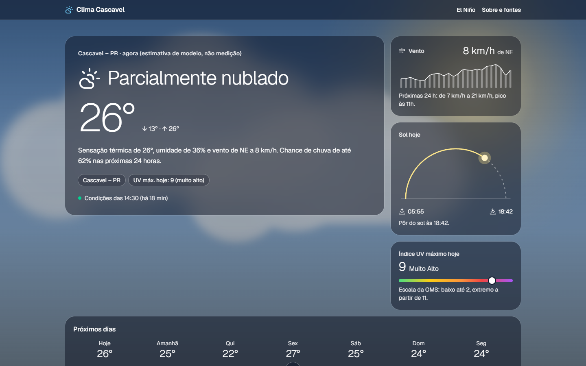
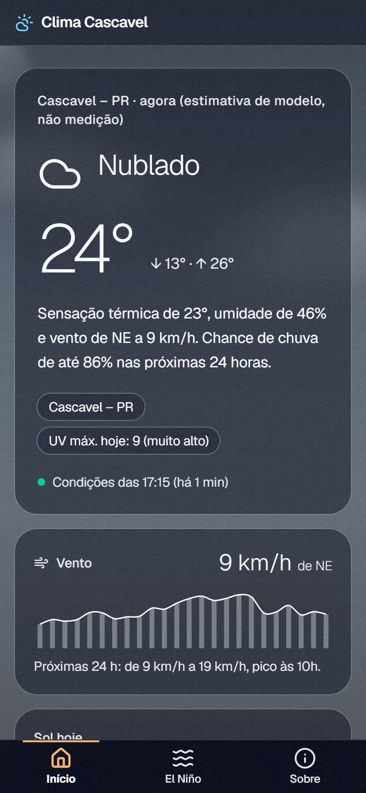
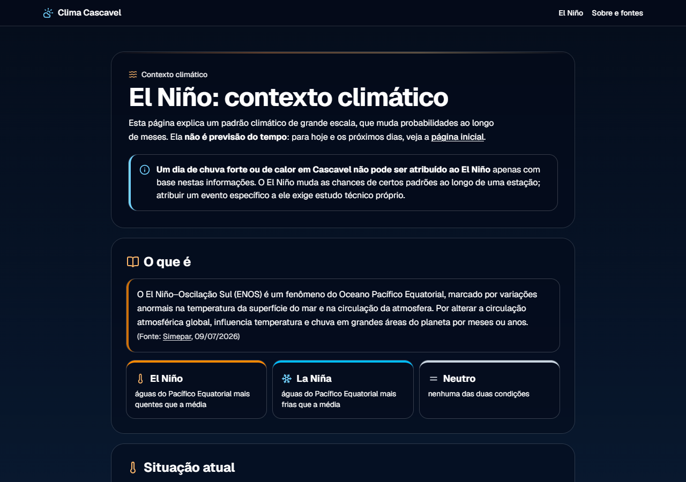
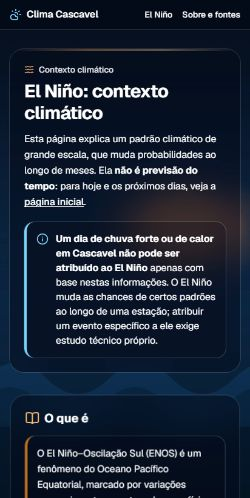

# Clima Cascavel – PR

Condições atuais e previsão do tempo para Cascavel, Paraná, com contexto
educativo sobre El Niño. Projeto de portfólio, sem fins comerciais.

> **EN summary:** Portfolio weather web app for Cascavel (Paraná, Brazil).
> Next.js + TypeScript, server-side caching of the free Open-Meteo API, explicit
> handling of stale data and provider failures, and a strict separation between
> forecasts, official alerts and El Niño climate context. Animated weather scenes
> drawn in code (CSS, SVG and canvas) with WCAG contrast guaranteed by tests.

**Site:** https://cascavel-clima.vercel.app

| Início (desktop) | Início (celular) |
|---|---|
|  |  |
| **El Niño (desktop)** | **El Niño (celular)** |
|  |  |

<sub>Capturas de 15/10/2026 com dados reais do momento; a cena muda com o tempo em Cascavel.</sub>


## Princípios

- **Previsão ≠ alerta oficial ≠ contexto climático.** O site exibe previsão de
  modelo numérico, aponta para fontes oficiais de alerta (sem emitir ou
  interpretar alertas) e explica El Niño citando fonte e data.
- **Nada inventado.** Sem dado válido, o site mostra "indisponível", nunca
  valores de exemplo. Dados antigos aparecem com aviso de idade.
- **Nenhuma chave no navegador.** O navegador fala só com o nosso servidor.

## Visual

Inspirado no conceito [Weather & Forecasting Web Design](https://dribbble.com/shots/25898869-Weather-Forecasting-Web-Design),
do **Gapsy Studio** (Dribbble): cena de fundo que muda com o tempo e cards de vidro.
A identidade visual e todas as ilustrações deste projeto são próprias, desenhadas
em código; nenhuma imagem do design original é usada.

- **Cenas animadas** (`src/components/scene/`): céu limpo, sol, lua e estrelas,
  nuvens, névoa, garoa, chuva (intensidade pelo código do tempo), trovoada com
  raios e neve; cena neutra quando o dado expira. A escolha é lógica pura
  (`src/lib/weather/scenes.ts`), testada para todos os códigos WMO.
- **Widgets da Início:** vento das próximas horas, arco do sol (nascer, pôr e
  posição atual), índice UV na escala da OMS e curva dos 7 dias, além do resumo em
  texto feito só com dados (sem linguagem de alerta).
- **Página El Niño:** oceano com ondas e "mancha quente" (ilustração, sem dados),
  entrada animada e números em destaque, cada um com fonte e conferido por teste
  contra o texto da mesma fonte.
- **Contraste garantido por teste:** as cores ficam numa paleta única
  (`scene-palette.ts`) e `tests/contrast.test.ts` calcula o contraste WCAG do
  texto branco no pior caso de cada cena (centro do sol, nuvem branca, mancha
  quente) sob o véu mais fraco: ≥ 4,5:1 nos cards e nos balões internos.
- **Movimento com responsabilidade:** quem desativa animações no sistema vê as
  cenas paradas e sem raios; raios a cada 6–15 s com no máximo 2 clarões
  (WCAG 2.3.1); chuva e neve pausam com a aba em segundo plano ou fora da tela.
- **Galeria de cenas:** `npm run dev` e abra `/dev/cenas` (só em desenvolvimento;
  responde 404 em produção).

## Rodando localmente

Requer Node.js 22 ou superior.

```bash
npm install
npm run dev        # http://localhost:3000
npm test           # testes (Vitest)
npm run lint
npm run typecheck
npm run build
```

Não há variáveis de ambiente obrigatórias hoje. Veja `.env.example`.

## Arquitetura

```
Navegador ──▶ Next.js (servidor, Vercel) ─┬─▶ cache (10 min) ──▶ Open-Meteo
                         │                 └─▶ cache (6 h)    ──▶ NOAA CPC (El Niño)
                         ├─ GET /api/weather (JSON normalizado)
                         └─ GET /api/enso    (JSON do El Niño)
```

Três camadas de proteção contra dado ruim ou velho (as mesmas para a previsão e
para o El Niño):

1. **Serviço** (`src/lib/sources/resilient-source.ts`, usado por `weather/service.ts` e `enso/service.ts`): timeout de 8 s, uma retentativa só
   para erros transitórios. O último dado bom fica no Runtime Cache da Vercel
   (`last-good-store.ts`, compartilhado entre instâncias, válido por 24 h) e é
   usado como fallback se o provedor falhar.
2. **Cache remoto** (`get-weather.ts`, `"use cache: remote"`, Runtime Cache da
   Vercel): no máximo uma chamada ao provedor a cada 10 min, compartilhada entre
   todas as instâncias; falhas nunca entram no cache. O `"use cache"` comum
   (em memória) não bastava na Vercel: verificado no site publicado, cada visita
   chamava o Open-Meteo. O cache remoto recomeça a cada novo deploy.
3. **Visão por requisição** (`freshness.ts`): idade calculada a cada acesso; dado
   expirado some da tela e da API; horas e dias passados são removidos.

| Pasta | Conteúdo |
|---|---|
| `src/lib/config.ts` | Cidade, coordenadas, TTL do cache, limites de frescor, fontes oficiais |
| `src/lib/providers/` | Open-Meteo (validação rígida com zod: unidades, fuso, faixas) e NOAA CPC (parsers estritos dos arquivos de texto e do boletim) |
| `src/lib/sources/` | Busca com retentativa e último dado bom, comum a todas as fontes |
| `src/lib/enso/` | Dados do El Niño: três fontes independentes (semanal, RONI, boletim), cache de 6 h e frescor pela data do próprio dado |
| `src/lib/weather/` | Normalização, códigos WMO em PT-BR, serviço, cache, frescor, cenas, paleta e leituras dos widgets (`insights.ts`) |
| `src/lib/format.ts` | Formatação pt-BR com fuso explícito (`America/Sao_Paulo`) |
| `src/components/enso/` | Painel ao vivo do El Niño e gráfico de anomalias (cores validadas, tabela e navegação por teclado) |
| `src/components/scene/` | Cenas animadas (tempo e oceano), chuva/neve em canvas, raios |
| `src/components/home/` | Cards de vidro e widgets da Início |
| `src/components/` | Demais componentes da interface |
| `src/content/el-nino.ts` | Conteúdo curado do El Niño, com fonte por afirmação |
| `src/app/` | Páginas (`/`, `/sobre`, `/el-nino`), `GET /api/weather` e `GET /api/enso` |
| `tests/` | Testes (Vitest), incluindo regras de texto proibido |

## Qualidade

- **473 testes** cobrindo: validação dos provedores (com cópias reais dos arquivos do NOAA), normalização, fuso perto da
  meia-noite, regras de frescor, retentativa e fallback compartilhado, estados
  da tela (fresco, velho, expirado, indisponível), cenas para todos os códigos do
  tempo, contraste WCAG no pior caso de cada cena, widgets (UV, sol, vento, curva),
  acessibilidade das listas roláveis, conteúdo do El Niño, página 404, avaliação do
  monitoramento, ausência de texto escuro no tema escuro e uma varredura de frases
  proibidas ("sem alertas", "causado pelo El Niño"…).
- **CI** (`.github/workflows/ci.yml`): lint, tipos, testes e build em todo push e PR.
- **Monitoramento** (`.github/workflows/monitor.yml` + `scripts/check-health.mjs`):
  a cada 30 min verifica as páginas e as APIs publicadas; se algo cair, a
  previsão ficar velha ou os dados do El Niño pararem de ser atualizados (NOAA
  fora do ar ou formato dos arquivos mudou), a execução falha e o GitHub avisa por e-mail. Rodar à
  mão: `node scripts/check-health.mjs`. O GitHub desativa agendamentos de
  repositórios públicos após 60 dias sem commits (reativar na aba Actions).
- **Boletim do El Niño** (`.github/workflows/enso-boletim.yml` + `scripts/check-enso-bulletin.mjs`):
  duas vezes por dia confere se o NOAA publicou boletim mais novo que o usado nos
  textos da página; se sim, abre uma issue (uma por boletim) com a lista do que
  revisar, e o GitHub avisa por e-mail. Ao mesmo tempo, o site já mostra um aviso no
  topo da página El Niño (e “mudou no boletim” na Início, se a situação mudar).
- **App instalável (PWA):** manifesto (`src/app/manifest.ts`), ícones gerados de
  `src/app/icon.svg` por `scripts/make-icons.mjs`, menu inferior no celular e um service
  worker mínimo (`public/sw.js`) que, sem internet, mostra a página `/offline`. Nenhum dado
  do tempo ou do El Niño fica guardado no aparelho; só os arquivos do visual do site.
- **Segurança:** cabeçalhos CSP (parcial), HSTS, `nosniff`, `X-Frame-Options`,
  `Referrer-Policy` e `Permissions-Policy` em todas as respostas (`next.config.ts`).
- **Lighthouse** (celular, com animações ativas, build de produção do novo visual, 15/10/2026):

  | Página | Performance | Acessibilidade | Boas práticas | SEO | CLS |
  |---|---|---|---|---|---|
  | Início | 96 | 100 | 100 | 100 | 0 |
  | El Niño | 98 | 100 | 100 | 100 | 0 |
  | Sobre | 98 | 100 | 100 | 100 | 0 |

- **Segredos:** nenhuma chave no projeto; o JavaScript enviado ao navegador não
  contém referências ao provedor nem padrões de chave/token.

## Deploy (Vercel, plano Hobby)

1. Crie uma conta em [vercel.com](https://vercel.com) entrando com o GitHub.
2. **Add New → Project**, importe este repositório e mantenha as opções padrão
   (o framework Next.js é detectado sozinho). Não há variáveis de ambiente.
3. Cada `git push` na branch `main` publica uma nova versão; outras branches
   geram uma versão de prévia com endereço próprio.
4. Recomendado: no GitHub, **Settings → Branches → Add branch ruleset** para a
   `main`, exigindo que o check **CI** passe antes de mesclar um pull request.
   Assim nenhuma mudança com teste quebrado chega ao site.

## Escopo da v1

**Inclui:** condições atuais, próximas 24 h, próximos 7 dias, vento das próximas
horas, nascer/pôr do sol, índice UV, indicador de atualização, links para alertas
oficiais, página El Niño e página Sobre/Fontes, com cenas animadas e tema escuro.
Prioridade para o navegador do celular.

**Fora da v1** (cada item só entra com aprovação): outras cidades, login,
notificações, integração automática de alertas do INMET, dados observados de
estação, radar/mapas, histórico, status do El Niño automático,
PWA/app nativo, tema claro, outros idiomas, monetização.

## Fontes e atribuição

- **Dados meteorológicos:** [Open-Meteo.com](https://open-meteo.com/), licença
  [CC BY 4.0](https://open-meteo.com/en/licence). A licença exige um link para
  o Open-Meteo ao lado de onde os dados aparecem.
- **Escala do Índice UV:** [OMS – Global Solar UV Index: a practical guide](https://www.who.int/publications/i/item/9241590076).
- **Design de referência:** [Weather & Forecasting Web Design – Gapsy Studio](https://dribbble.com/shots/25898869-Weather-Forecasting-Web-Design) (inspiração; nada do material original é usado).
- **Alertas oficiais (só links):** [INMET – Avisos](https://avisos.inmet.gov.br/),
  [Defesa Civil do Paraná](https://www.defesacivil.pr.gov.br/).
- **Dados do El Niño, atualizados automaticamente:** [NOAA Climate Prediction Center](https://www.cpc.ncep.noaa.gov/)
  (domínio público, governo dos EUA): [temperatura semanal das regiões Niño](https://www.cpc.ncep.noaa.gov/data/indices/wksst9120.for),
  [RONI trimestral](https://www.cpc.ncep.noaa.gov/data/indices/RONI.ascii.txt) e situação do
  [boletim mensal](https://www.cpc.ncep.noaa.gov/products/analysis_monitoring/enso_advisory/ensodisc.shtml).
- **El Niño – textos** (conteúdo curado à mão em `src/content/el-nino.ts`, conferido em 14/10/2026):
  [NOAA CPC – ENSO Diagnostic Discussion](https://www.cpc.ncep.noaa.gov/products/analysis_monitoring/enso_advisory/ensodisc.shtml) (08/10/2026),
  [Painel El Niño 2026–2027, Boletim nº 4 – INPE/INMET](https://www.gov.br/inpe/pt-br/assuntos/ultimas-noticias/painel-el-nino-2026-2027-quarto-boletim-sobre-o-monitoramento-do-fenomeno-no-brasil-e-publicado) (01/10/2026),
  [Simepar](https://www.simepar.br/simepar/post/77062) (09/07/2026) e
  [notas técnicas Defesa Civil PR/Simepar](https://www.defesacivil.pr.gov.br/Pagina/NOTAS-TECNICA-CONJUNTA-EL-NINO-OSCILACAO-SUL-ENOS-2026).

### Como atualizar o conteúdo do El Niño

1. Leia o boletim mais recente do NOAA CPC (mensal) e do Painel El Niño (INPE/INMET).
2. Edite `src/content/el-nino.ts`: textos, `publishedAt` de cada fonte, `reviewedAt` e
   `nextExpectedUpdate`. Toda afirmação precisa de uma fonte (`source`).
3. Edite `src/content/el-nino-bulletin.json` com a data e a situação do boletim do NOAA
   que você usou. Isso tira o aviso de “boletim novo” do site.
4. Rode `npm test`: os testes conferem fontes, datas e frases proibidas (e que o
   boletim do JSON é o mesmo citado como fonte).

A página mostra um aviso automático quando sai boletim novo do NOAA (destacado se a
situação mudar), ou se passar a data do próximo boletim ou 45 dias desde a revisão.

## Verificações da Etapa 0 (2026-10-14)

| Item | Resultado | Fonte |
|---|---|---|
| Coordenadas | -24.95583, -53.45528, 786 m, `America/Sao_Paulo` (GeoNames 3466779). Há outro "Cascavel" no PR (distrito de Guarapuava): **não usar** | Open-Meteo Geocoding |
| Open-Meteo: uso grátis | Só não comercial: sem assinatura nem anúncios | [Termos](https://open-meteo.com/en/terms) |
| Open-Meteo: limites | 600/min, 5.000/h, 10.000/dia, 300.000/mês. Nosso uso estimado: ≤ 144/dia | [Termos](https://open-meteo.com/en/terms) |
| Open-Meteo: atribuição | CC BY 4.0; link "Weather data by Open-Meteo.com" junto aos dados | [Licença](https://open-meteo.com/en/licence) |
| Vercel Hobby | Grátis, **só uso pessoal/não comercial**; 1M invocações de função/mês, 100 GB de transferência. Se passar do limite, o recurso pausa (sem cobrança) | [Hobby](https://vercel.com/docs/plans/hobby) |
| Alertas INMET | Endereço ativo: `avisos.inmet.gov.br` (`alertas2` recusa conexão). O servidor recusa clientes que não se identificam como navegador, por isso a integração automática fica fora da v1 | Teste de conexão |
| Alerta por SMS | Enviar CEP para 40199 (gratuito) | [Paraná – Defesa Civil](https://www.parana.pr.gov.br/servicos/Seguranca/Defesa-Civil/Receber-alertas-da-Defesa-Civil-por-SMS-ERrZ4PN6) |

**Gatilho de revisão:** se o projeto passar a ter receita, anúncios ou
assinatura, os planos grátis do Open-Meteo e da Vercel deixam de valer.

## Plano de etapas

0. ✅ Base do projeto
1. ✅ Provedor Open-Meteo + validação + normalização
2. ✅ Serviço com cache, frescor e tratamento de falhas + `/api/weather`
3. ✅ Tela Início
4. ✅ Página Sobre/Fontes + atribuição + bloco de alertas
5. ✅ Página El Niño (conteúdo revisado pelo autor)
6. ✅ Deploy na Vercel + verificação de segredos no bundle + Lighthouse

**Pacote de robustez:** ✅ CI, monitoramento agendado, fallback compartilhado,
cabeçalhos de segurança, teclado na lista de horas, 404 em português.

**Novo visual:**

- D1. ✅ Dados novos: vento por hora, nascer/pôr do sol, UV máximo
- D2. ✅ Sistema de cenas animadas
- D3. ✅ Nova Início com widgets
- D4. ✅ Página El Niño com cena de oceano; tema escuro em todo o site
- D5. ✅ README, crédito ao design de referência e revisão final

**Melhorias gerais:**

- M1. ✅ App instalável (PWA), página sem conexão e menu inferior no celular
- M2. ✅ Atualização automática com a aba aberta (10 min na Início, 30 min no El Niño), transição suave entre cenas e céu de amanhecer/entardecer (até 40 min do nascer/pôr do sol)
- M3. Detalhe do dia com barras de chuva
- M4. Pequenos ajustes

**El Niño ao vivo:**

- E1. ✅ Dados automáticos do NOAA CPC + `/api/enso` + monitoramento
- E2. ✅ Painel “Agora no Pacífico”: situação oficial, régua do Niño 3.4, 52 semanas, 4 regiões e RONI (gráficos com tabela e teclado); mancha quente do oceano ligada ao dado; resumo na Início
- E3. ✅ Aviso no site quando sai boletim novo (destaque se a situação mudar) + issue automática para revisar os textos
